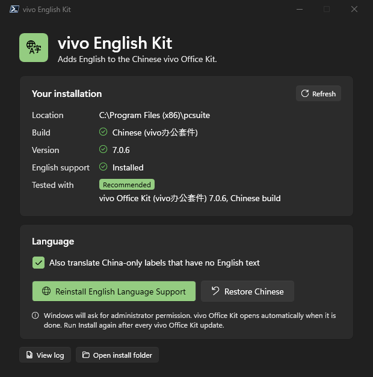

# vivo Office Kit in English (for China-market vivo phones)

Use the **Chinese** vivo Office Kit (vivo办公套件) on Windows **in English**, so your
China-market vivo phone keeps connecting to your PC.

## Why you need this

vivo makes two versions of Office Kit for Windows:

| | Global version | Chinese version (vivo办公套件) |
|---|---|---|
| Language | English | Chinese only |
| Works with China-market phones | ❌ No | ✅ Yes |

If your phone is a China-market model (for example a vivo X200 Ultra bought in China),
only the Chinese version connects to it, and that version has no language setting.
This kit adds English to the Chinese version. Everything else (your vivo account, servers,
phone connection) stays exactly as vivo built it.

## Before you start

- Windows **10 or 11**. Nothing else to install: it uses the PowerShell that comes with Windows.
  (If you have PowerShell 7.5 or newer, the window gets the Windows 11 look automatically.)
- The **Chinese** vivo Office Kit installed from vivo's Chinese website.
- Tested with: vivo Office Kit **7.0.6** (Chinese build) on Windows 11, with a vivo X200 Ultra (China).
  Other versions will probably work too. The app tells you if something looks different.

## How to use it

1. **Download:** open the [latest release](../../releases/latest) and download the `.zip` file.
2. **Unzip it:** right-click the zip, choose **Extract All…**, then **Extract**.
3. **Open the kit:** in the extracted folder, double-click **`vivo English Kit.cmd`**.
4. **Install English:** click **Install English Language Support**.
5. **Allow it:** Windows asks *"Do you want to allow this app to make changes?"* Click **Yes**.
6. **Done:** vivo Office Kit closes, gets updated, and opens again in English. 🎉

> **Windows says "Windows protected your PC"?** That happens with files downloaded from the
> internet. Click **More info**, then **Run anyway**.

### Prefer no window?

Double-click **`Install-English.cmd`** instead. It does the same thing in one step.

## Undo (back to Chinese)

Open **`vivo English Kit.cmd`** and click **Restore Chinese**, or double-click
**`Restore-Chinese.cmd`**. Your original files are put back exactly as they were.

## After a vivo Office Kit update

Updates replace the app's files, so it will be in Chinese again. Just run the kit again
(step 3 onwards). It only takes a few seconds.

## What gets translated

- The whole app interface that vivo already translated for its Global version.
- China-only features that vivo never translated, using vivo's own English names where they
  exist: **Origin Notes**, **Calendar**, **Albums**, **Recorder**, **To-dos**, the cloud services
  (Contacts, Cloud Drive, Find My Device…), sync prompts, search and sort options.

Some less-used screens and dialogs may still show a little Chinese. If you spot one, open an
[issue](../../issues) with a screenshot.

You can turn off the extra translations with the **"Also translate China-only labels"** checkbox.

## Troubleshooting

| Problem | What to do |
|---|---|
| "vivo Office Kit installation not found" | Install the Chinese vivo Office Kit first, then try again. |
| "This is the GLOBAL build" | You have the Global version, which is already English. This kit is only for the Chinese version. |
| The app is still Chinese | Close vivo Office Kit completely (also from the system tray) and run the kit again. |
| Something else | Click **View log** in the kit window and open an [issue](../../issues) with the log text. |

## What it changes (technical)

- `resources\app.asar` in the vivo Office Kit folder:
  - Removes the code that forces Chinese when the app is the Chinese build.
  - Translates the labels listed in `translations.json`.
  - The original is saved next to it as `app.asar.en-kit.bak`, and Restore puts it back.
- `%APPDATA%\pcsuite\config.json` and `config.ini`: sets the language to English.

It does **not** change `build-config.json`, vivo's servers, your account, or anything to do with
how the phone connects. A log of every run is written to `patch-log.txt` in the kit folder.

Command line (PowerShell): `Add-VivoEnglish.ps1 [-Restore] [-NoLabelTranslation] [-InstallDir <path>]`.
Exit codes: `0` success, `1` install not found, `2` Global build detected.

## Leave a tip ☕

If this saved you some frustration, you can buy me a coffee:

## Disclaimer

This is an unofficial, community-made tool. It is not affiliated with, endorsed by, or supported
by vivo. It changes files of an installed app: use it at your own risk. You can always undo it
with **Restore Chinese** or by reinstalling vivo Office Kit.

## License

[MIT](LICENSE)
